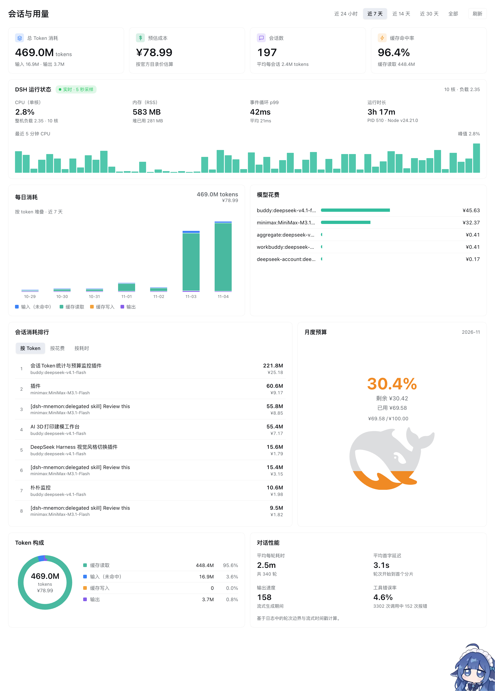

# dsh-usage-stats · 会话与用量

DSH（DeepSeek Harness）的用量仪表盘插件：从真实的会话投影缓存里统计 **token 消耗、估算成本、会话数、缓存命中率**，并展示 **月度预算水位** 与 **宿主进程运行状态（CPU / 内存 / 事件循环 / 运行时长）**。

界面按官方「会话统计」宣传片的工作台排版复刻，单页滚动，无第三方依赖。

## 安装

把仓库地址发给 DSH 里的助手，说「装这个插件」：

```
github:Stopning/dsh-usage-stats
```

助手会走 bundle 机制安装并自动排期重启。装好后侧栏出现「会话与用量」，位于「插件」与「自动化任务」之间。

> 别手改 profile 的 `package.json` 或 `cordis.patch.yml`，也别拷进 `node_modules` 手动改 —— 那样升级会丢。



---

## 功能

**KPI 卡（随顶部时间范围联动）**

| 卡片 | 内容 |
|---|---|
| 总 Token 消耗 | 四类 token 合计，副标拆出未缓存输入 / 输出 |
| 预估成本 | 按模型目录价折算的人民币金额，副标注明计价口径 |
| 会话数 | 范围内会话总量，副标给出平均每会话 token |
| 缓存命中率 | `cacheRead / (cacheRead + uncached)`，副标为缓存读取总量 |

**DSH 运行状态**（每 5 秒采样，与官方一致；`CPU_HISTORY = 60` 个点正好铺满最近 5 分钟）

- CPU（单核）百分比 + 整机负载 + 核数
- 内存 RSS + V8 堆已用 / 堆总量
- 事件循环延迟 p99 与均值（`monitorEventLoopDelay`，每次采样后 reset）
- 进程运行时长、PID、Node 版本
- 最近 5 分钟 CPU 柱状图 + 峰值

**每日消耗**：按 token 类型堆叠的四色柱状图，右上角显示范围总量与金额。

**模型花费**：按模型列出金额与占比条。

**会话消耗排行**：可切换「按 Token / 按花费 / 按耗时」，取值随档位联动显示（耗时档显示耗时 + 轮次，花费档显示金额 + token）。

**Token 构成**：环形图 + 四项明细（缓存读取 / 未缓存输入 / 缓存写入 / 输出）及百分比。

**对话性能**：平均每轮耗时、平均首字延迟（TTFT）、输出速度（tok/s）、工具错误率。

**月度预算**

- 统计**固定为当前自然月**，不随顶部范围变化
- 点击金额即可就地编辑上限，回车保存、Esc 取消；值存在插件私有文件里，刷新不丢
- 鲸鱼水位 = **剩余额度**（`1 - 已用 / 上限`）：月初接近满格，花得越多水位越低，颜色随之从黑变绿黄橙红

| 剩余比例 | 颜色 |
|---|---|
| ≥ 95% | 墨黑（跟随主题前景色） |
| 95% – 75% | 绿 `#31BD9D` |
| 75% – 55% | 黄 `#E0B23C` |
| 55% – 25% | 橙 `#F08A24` |
| < 25% | 红 `#E2453C` |

---

## 安装细节

插件通过 DSH 的 bundle 机制安装，**不要手改 profile 的 `package.json` 或 `cordis.patch.yml`**。

对助手说「装这个插件」，或直接指定来源：

```
github:Stopning/dsh-usage-stats          # 从 GitHub
/path/to/dsh-usage-stats                 # 从本地路径
```

底层走的是 `plugin_manager` 的 `install_bundle`：

```bash
plugin_manager{ action: "install_bundle", target: "github:Stopning/dsh-usage-stats" }
```

生效方式：

- 修改 `client.js` → **刷新页面**即可（客户端 bundle 的 revision 由文件 mtime + size 算出）；
- 修改 `index.js` → **重启宿主**。可排队等空闲重启：`~/.dsh/bin/dsh-restart-idle`。


---

## 数据来源

插件不解析原始会话日志，读的是 DSH 已经维护好的两份缓存：

| 数据 | 位置 / 通道 |
|---|---|
| 每会话 token、耗时、按天成本 | `storageDomain` → `session_projcache` → `sessions` 表 |
| 宿主进程指标 | `node:os` + `node:perf_hooks`，进程内直接采样 |

会话记录里用到的主要字段：

```js
record.rows.tokenUsage.val.totals     // { uncachedInputTokens, outputTokens, cacheReadTokens, cacheWriteTokens }
record.rows.sessionStats.val          // { turns, steps, llmMs, toolMs, ttftMs, ttftSteps, decodeMs, decodeTokens }
record.rows.contextActivity.val.days  // { 'YYYY-MM-DD': { tokens, turns, wallMs, cost: { provider: { model: { peak|off: {...} } } } } }
record.rows.modelSelection.val.lastUsed // { provider, model }
record.rows.title.val                 // 会话标题
```

按天成本由 `contextActivity.days[date].cost` 的四类 token 乘以价目表得到。价目表按四级回退：**模型定价 → 本渠道 provider 定价 → 跨渠道 `proxied` 定价 → 默认价兜底**（兜底时该模型标记为「估算」）。成本换算只做一次，宿主下发 `cost.display`，客户端不再乘汇率。

### 关于月度预算的存储

预算上限不在 profile 配置里，而是插件自己的文件：

```
~/.dsh/storages/dsh-usage-stats/budget.json
{ "amount": 100, "updatedAt": "2026-11-03T19:36:16.225Z" }
```

这个文件**优先于** `Config.budgetAmount`。改值请走面板上的就地编辑或接口：

```bash
curl -X POST http://127.0.0.1:<port>/api/dsh-usage-stats/budget \
  -H 'Content-Type: application/json' \
  -H 'Cookie: dsh-auth-...' \
  -d '{"amount": 100}'
```

> ⚠️ 直接写 `budget.json` 不生效：宿主进程内存里的 `settings.budgetAmount` 才是权威值，只有走路由才会同步。改了文件不重启，面板仍按旧值算。

---

## HTTP 接口

四条路由，均为 `POST`，返回 `{ ok: true, value: ... }`：

| 路由 | 请求体 | 返回 |
|---|---|---|
| `/api/dsh-usage-stats/overview` | `{ range?, currency? }` | KPI、每日消耗、模型花费、Token 构成、对话性能、月度预算 |
| `/api/dsh-usage-stats/sessions` | `{ range?, limit?, currency? }` | 会话列表（含按天明细） |
| `/api/dsh-usage-stats/budget` | `{ amount }` | 写入后的预算上限 |
| `/api/dsh-usage-stats/cpu` | — | 一次宿主进程快照 |

`range` 可选 `24h` / `7d` / `14d` / `30d` / `all`。

---

## 配置

在 profile 的插件配置里覆盖（全部可选）：

```yaml
budgetAmount: 100        # 月度预算上限，被 budget.json 覆盖
budgetPeriod: month      # 目前只支持 month
defaultRange: 30d        # 默认时间范围
refreshIntervalMs: 5000  # CPU 采样与刷新间隔
topSessions: 200         # 一览里最多取多少会话
currency: CNY            # 计价货币
```

---

## 计价口径与已知限制

- **成本是估算，不是账单。** 价目表来自 models.dev 的 list price，未命中时回退到默认价并在界面标注「估算」。与实际扣费可能有出入，尤其在有折扣、套餐额度或峰谷计价的渠道。
- **缓存写入常为 0。** 多数渠道不上报 `cacheWriteTokens`，因此「缓存写入」一栏通常为零。
- **首字延迟与输出速度只能取全会话累计值。** `contextActivity.days` 的日桶里没有逐日 ttft / decode 数据，所以这两项不随顶部范围变化，其余「对话性能」指标随范围联动。
- **工具错误率来自命令统计**，粒度是「命令执行失败 / 命令执行总数」，不含非命令类工具调用。
- **预算按自然月**，不提供自定义起止日期。
- 面板高度固定在宿主中心列里，内容超出时面板内部滚动。

---

## 开发

零运行时依赖，源码两个文件：

| 文件 | 角色 |
|---|---|
| `index.js` | Host 半边：读投影缓存、算成本、采样 CPU、注册四条路由 |
| `client.js` | Client 半边：单页仪表盘 UI（`window.__ModuleLoader__.load` 注册） |
| `locale/{zh,en}.json` | 清单用的标题与描述 |
| `cordis.patch.yml` | bundle 注入声明 |
| `DESIGN.md` | 设计文档：排版、字段来源、实现决定与踩坑记录 |

> `index.js` 里自带一个 ~40 行的 `defineConfig`（standard-schema 最小实现）。之所以不引 zod：bundle 以符号链接装进 profile，裸导入会走工作区真实路径去找 `node_modules`，装了反而 `ERR_MODULE_NOT_FOUND`；而 Cordis 只要求 `Config["~standard"].validate()` 存在。

### 验证

```bash
# 宿主侧：用真实的投影缓存跑一遍路由，打印真实返回
node verify.host.mjs

# 界面侧：无头浏览器打开面板并截图（需要 playwright）
python3 verify.ui.py <port> [cookie] [out.png]
```

`verify.ui.py` 会自动从桌面版 Chromium 的 cookie 库里读最新的 `dsh-auth-*` cookie。可用环境变量覆盖：`UST_CHROME`（浏览器二进制路径）、`UST_COOKIE_DB`（cookie 库路径）。

### 改界面时

- 客户端改动 → 刷新页面。bundle revision 由 `mtime + size` 算出，文件变了就会重新拉取。
- 宿主改动 → 重启 DSH。
- 样式只用 `--dsw-alias-*` 主题 token，别写死颜色，否则深色/浅色皮肤下会翻车（踩过：`--dsw-alias-brand-primary` 在浅色皮肤下是近黑色）。

---

## License

MIT
